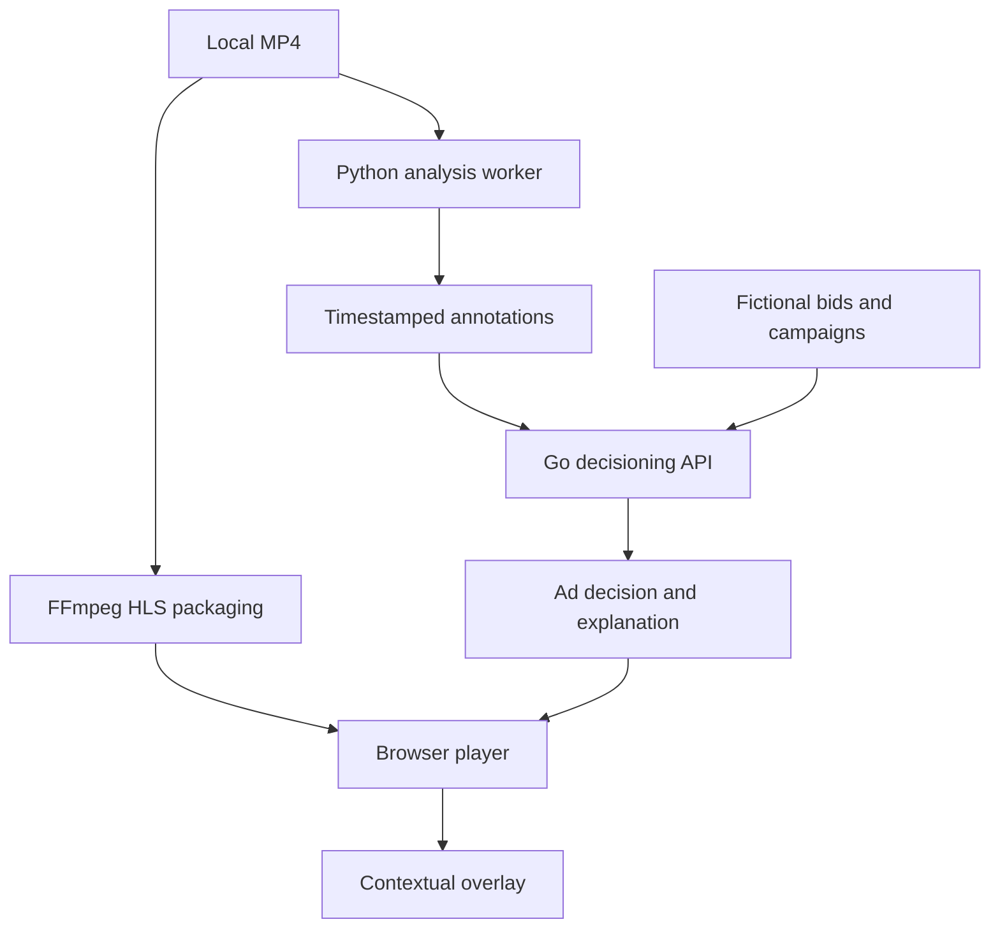

# SceneBid: AI Video Intelligence and Contextual Ad Decisioning
### by Raymond Gan

SceneBid is a local proof of concept that analyzes video and audio to find
timestamped contextual advertising opportunities. It uses a compilation of
1977 television commercials as a sample video.

The project combines real AI-generated video intelligence with fictional
advertiser campaigns and simulated bids. A Go decisioning service selects
eligible ads using the generated annotations and explains each decision.
The planned browser demo displays the selected ad as an overlay during video
playback.

## Problem

Streaming publishers need to understand what is happening at a particular
moment in a video, determine whether an ad is suitable, and choose among
advertisers interested in that context.

SceneBid explores the connection between:

- Multimodal video and audio understanding.
- Timestamped scene-level metadata.
- Contextual targeting and brand separation.
- Ad eligibility and auction decisions.
- Video playback and contextual ad presentation.

## Project Status

The initial Go starter currently probes a video with ffprobe, extracts a
single frame with FFmpeg, and selects from fictional bids against manually
supplied scene fixtures.

The real AI analysis worker, HLS player, contextual overlay, and mock
OpenRTB exchange are planned features. Update this section as each feature
is implemented and verified.

## MVP Scope

### Real analysis

- Read the local `TV_Commercials_1977.mp4` file.
- Detect visual shot boundaries and extract timestamped frames.
- Transcribe speech with faster-whisper.
- Analyze frames and transcript excerpts with AI models.
- Produce timestamped scene annotations containing visual and audio
  evidence, categories, and model metadata.
- Identify likely advertisers or products when supported by the available
  evidence; retain unknown values when uncertain.
- Optionally index embeddings for visual and transcript search.

### Simulated demand

- Load fictional campaigns and bids from local JSON fixtures.
- Evaluate campaign categories, bid floors, and configured separation rules.
- Return the winning eligible bid or a no-fill reason.
- Optionally exchange mock OpenRTB-style requests and responses between
  simulated SSP and DSP components.

### Real playback and presentation

- Package the source MP4 into an HLS playlist and media segments.
- Play the video in a browser.
- Use playback time and generated annotations to request an ad decision.
- Display the selected fictional campaign as a contextual overlay.

## Architecture



## Process Flow

1. Place the source MP4 under `data/input/`.
2. Analyze its audio and video to produce timestamped model-generated
   annotations.
3. Package the video into an HLS playlist and media segments.
4. Start the Go API and browser player.
5. During playback, look up the current video time in the annotations.
6. Evaluate fictional campaign bids against the current context and rules.
7. Display the winning overlay and the reason it was selected, or show a
   no-fill explanation.

Analysis happens before playback. Ad selection and overlay presentation
happen during playback.

## Priorities

### P0: End-to-end demonstration

- Real speech transcription and frame analysis on a short sample.
- Timestamped annotations with evidence.
- HLS playback in a browser.
- Fictional campaign selection using real generated annotations.
- Visible overlay and decision explanation.

### P1: Better analysis and decisioning

- Process the full video.
- Improve shot grouping and brand identification.
- Add configurable brand and competitor separation.
- Add basic safety handling and clear unknown/no-fill behavior.
- Evaluate selected predictions against manually verified examples.

### P2: Ad-tech integration

- Simulate SSP/DSP communication with mock OpenRTB-style requests and
  responses.
- Add request deadlines, no-bid behavior, and decision traces.
- Add simple playback and overlay event logging.

### P3: Search and future extensions

- Add CLIP/FAISS semantic search using ideas from In-Video Search.
- Explore linear video ads, VAST, and HLS-based SSAI separately.
- Explore live streaming analysis and low-latency updates.

## Repository Layout

- `cmd/scenebid/`: Go application entry point.
- `internal/`: Go analysis orchestration, decisioning, models, and storage.
- `analysis-worker/`: planned Python analysis worker.
- `web/`: planned browser player and overlay UI.
- `data/input/`: local source video and creative assets.
- `data/fixtures/`: fictional campaigns and bids.
- `data/output/`: generated media, analysis, and decision traces.
- `docs/`: design notes.

## Run and Verify

The current starter can be run with:

```bash
go test ./...
go run ./cmd/scenebid analyze -video data/input/TV_Commercials_1977.mp4 -at 5
go run ./cmd/scenebid decide
```

These commands currently probe the video, extract one frame, and run
decisioning against manually supplied scene fixtures. They do not yet run
AI analysis or display an ad.

Add setup, analysis, HLS, server, and browser commands here as those
features are implemented and verified.

## MVP Limitations

- Model outputs can be inaccurate; detected objects, brands, and safety
  assessments require validation.
- The input is a compilation of commercials, not a normal TV episode.
- Campaigns, bids, and demand-side participants are fictional.
- An overlay is rendered by the browser; this does not itself demonstrate
  server-side ad insertion.
- The project is not a production ad server or a claim of OpenRTB
  compliance.
- Source video and generated media should stay out of the repository.
- Verify usage and redistribution rights for video and creative assets.

## Ad Tech Terms

- **Publisher / supply:** The party providing an advertising opportunity.
- **Advertiser / demand:** The buyer seeking to show an advertisement.
- **SSP:** A platform representing or enabling publisher-side supply.
- **DSP:** A platform that evaluates opportunities for advertisers.
- **CPM:** The price per 1,000 impressions.
- **Bid floor:** The minimum eligible bid for an opportunity.
- **OpenRTB:** A protocol used to exchange programmatic bid requests and
  responses.
- **VAST:** A standard for describing video ad creatives and tracking.
- **SSAI:** Server-side ad insertion.
- **Impression:** A measured ad-display event, distinct from selecting an ad.
