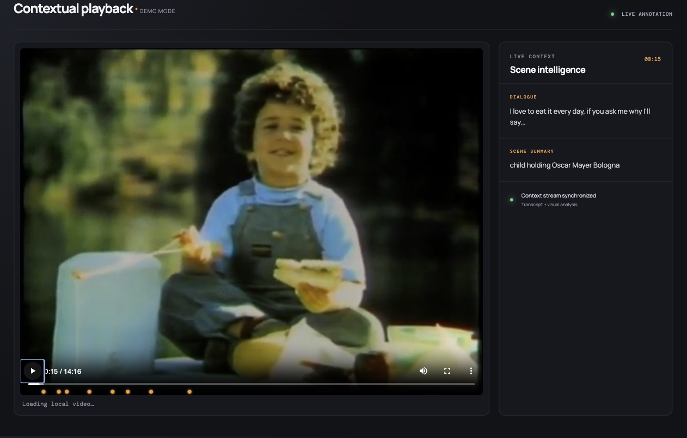
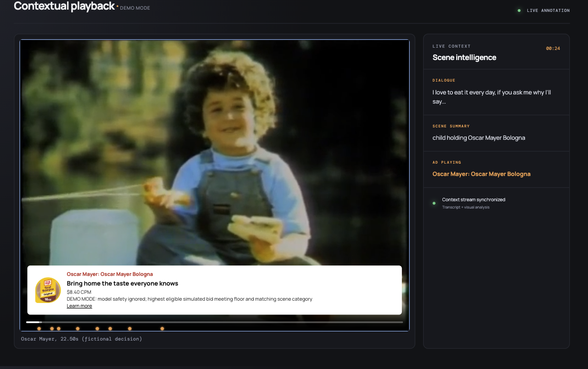
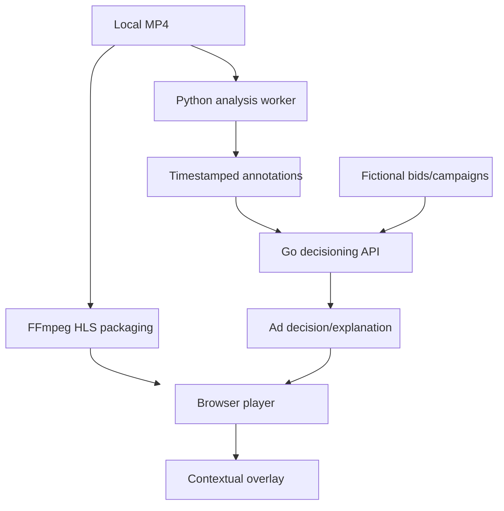
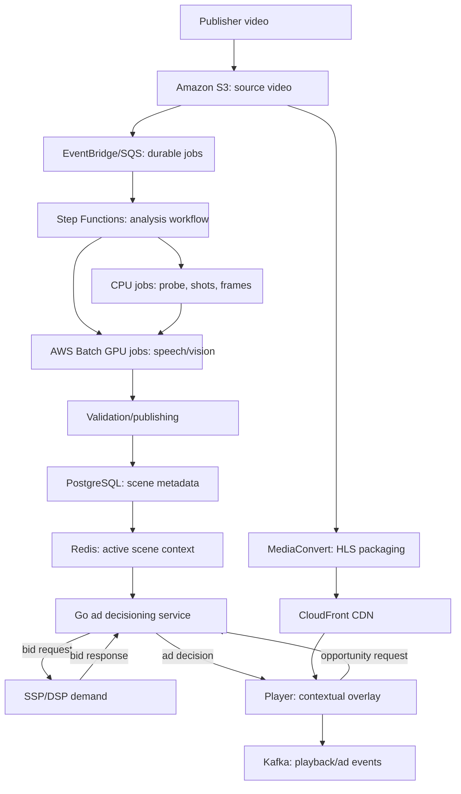
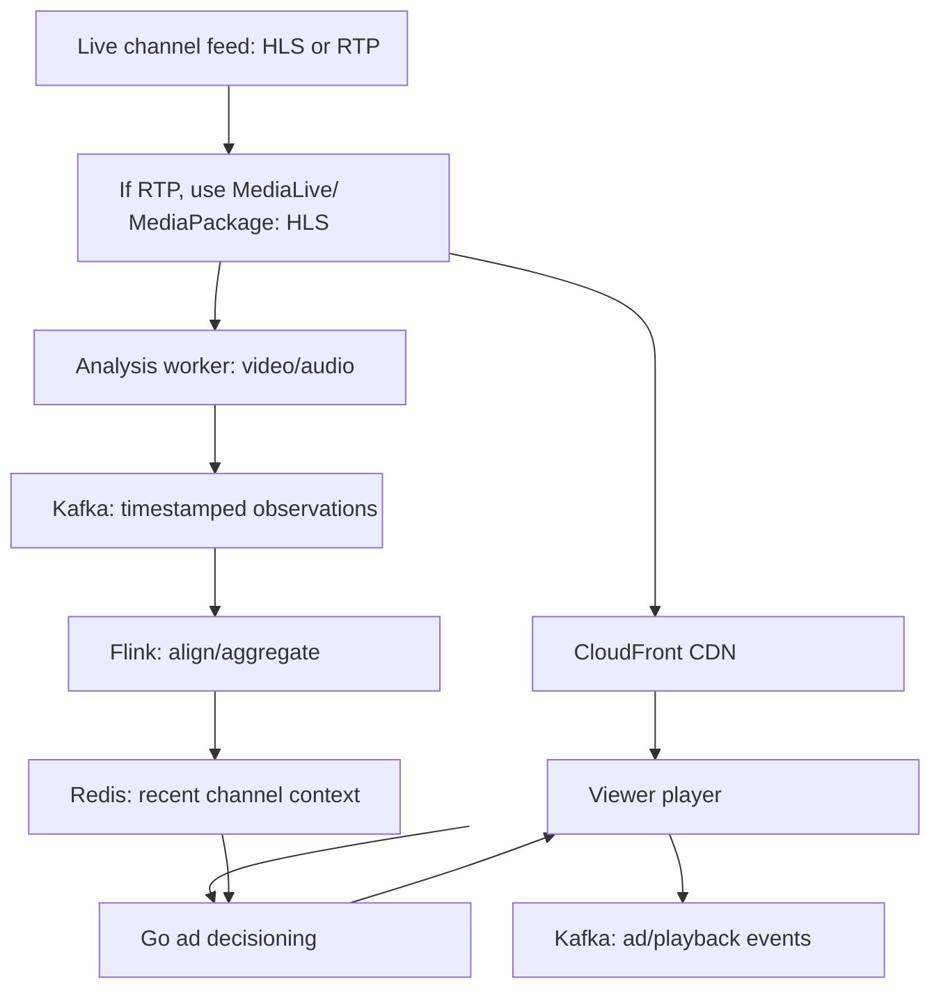

# SceneBid: AI Video Intelligence and Contextual Ad Decisioning

### by Raymond Gan. See [YouTube video](https://youtu.be/xCv5L5h6D8A) of my demo.

SceneBid is a local proof of concept that analyzes video and audio to find timestamped contextual ad opportunities. It uses a compilation of [1977 television commercials](https://archive.org/details/1977TVCommercials) as a sample video.

I combine real AI-generated video intelligence with fictional ad campaigns and simulated bids:

1. The [Python analysis worker](https://github.com/rayning0/scenebid/tree/main/analysis-worker) produces timestamped transcript and scene annotations.
2. The Go decisioning service generates simulated ad decisions and serves playback APIs. It picks eligible ads using the generated annotations and explains each decision.
3. The browser shows synchronized contextual information and overlay ads at the right video moments. It plays the video and shows contextual overlays, timestamped dialogue, scene summaries, and active ad info.

Relevant Go decisioning code:

- [`cmd/scenebid/main.go`](cmd/scenebid/main.go): implements the `decide` command and the HTTP `serve` mode, including the `/api/decision`, `/api/opportunities`, and `/api/context` playback endpoints.
- [`internal/auction/auction.go`](internal/auction/auction.go): evaluates bids and selects eligible winners or returns no-fill decisions.
- [`internal/model/model.go`](internal/model/model.go): defines bids and ad decision data structures.
- [`internal/model/contract.go`](internal/model/contract.go): defines the generated analysis and ad-opportunity contract consumed by decisioning.

## Problem

Streaming video publishers must understand what's happening at a specific moment in a video, decide if an ad matches that moment, and choose among advertisers interested in that context.

SceneBid explores the relation between:

- Multimodal video and audio AI understanding.
- Timestamped scene-level metadata.
- Contextual ad targeting and brand separation.
- Ad eligibility and auction decisions.
- Video playback and contextual ad presentation.

## Demo

I finished the "P0: end-to-end" local demo for my sample video!

Place `TV_Commercials_1977.mp4` in `data/input/` before starting the demo. You can generate HLS assets separately using the FFmpeg command in [Run and Verify](#run-and-verify). The browser falls back to the local MP4 when HLS is unavailable.

1. In Terminal, first run `go run ./cmd/scenebid serve`
2. Playing my `TV_Commercials_1977.mp4` video in http://localhost:8080/ shows this:

- Start of video, showing Oscar Mayer bologna commercial. No overlay ad yet:



- At 22.5 secs, it shows overlay ad #1 at bottom of video. It's for Oscar Mayer Bologna. Clicking "Learn more" link opens Oscar Mayer site:



- At 67.5 secs, overlay ad #2, for Del Monte corn:


- At 157.5 secs, overlay ad #3, for "Hardy Boys and Nancy Drew Mysteries" TV show:


- At 187.5 secs, overlay ad #4, for Triscuit wafers:


3. In 2 cases, we see overlay ads:

- If video naturally hits that ad time while playing.
- If we click orange dot placed at the ad time.

4. Right side shows **Dialogue**, which changes as video plays.
5. Right side shows **Scene Summary**, AI understanding of what's happening in each scene.
6. As each ad pops up, right side shows **Ad Playing**.

Mock OpenRTB exchange behavior remains exploratory; campaign demand and bids are still fictional.

## MVP Scope

### Real analysis

- Read the local `TV_Commercials_1977.mp4` file.
- Detect visual shot boundaries and extract timestamped frames.
- Transcribe speech with `faster-whisper`.
- Analyze frames and transcript excerpts with AI models.
- Produce timestamped scene annotations containing visual and audio evidence, categories, and model metadata.
- Identify likely advertisers or products when supported by the available evidence; retain unknown values when uncertain.

### Simulated demand

- Load fictional campaigns and bids from local JSON fixtures.
- Match fictional campaigns against detected categories or entities and apply a simulated bid floor of $2 CPM by default.
- Record the model's safety assessment in the simulated decision.
- Return the winning eligible bid or a no-fill reason.

### Real playback and presentation

- Play HLS assets when available or fall back to the local MP4.
- Use playback time and generated annotations to request an ad decision.
- Display the selected fictional campaign as a bottom banner overlay.
- Show a campaign logo from each campaign's `logo_url` fixture field.
- Synchronize transcript dialogue and scene summaries in the live context panel.
- Mark ad opportunities on the playback timeline.

## Architecture



## Process Flow

1. Place the source MP4 under `data/input/`.
2. Analyze its audio and video to produce timestamped model-generated annotations.
3. Optionally package the video into an HLS playlist and media segments.
4. Start the Go API and browser player.
5. Load candidate timestamps from `/api/opportunities`.
6. Evaluate fictional campaign bids against the matching context when the browser calls `/api/decision`.
7. Display the winning overlay, campaign logo, and decision reason, or show a no-fill explanation.
8. Update the dialogue, scene summary, and active-ad panel as playback time advances.

Video analysis happens offline. The browser requests simulated ad decisions when loading the timeline and can refresh them during playback. It displays the selected overlays at the matching timestamps.

## Priorities

### P0: End-to-end demonstration

- Real speech transcription and frame analysis on a short sample.
- Timestamped annotations with evidence.
- HLS playback in a browser.
- Fictional campaign selection using real generated annotations.
- Visible overlay and decision explanation.

### P1: Better analysis and decisioning

- Process the full video.
- Improve shot grouping and brand identification.
- Enforce configurable brand and competitor separation.
- Enforce brand-safety rules and define when unknown safety results in no-fill.
- Evaluate selected predictions against manually verified examples.

### P2: Ad-tech integration

- Simulate SSP/DSP communication with mock OpenRTB-style requests and responses.
- Add request deadlines, no-bid behavior, and decision traces.
- Add simple playback and overlay event logging.

### P3: Search and future extensions

- Add embedding-based visual and transcript search with CLIP/FAISS using ideas from [In-Video Search](https://github.com/rayning0/ivs).
- Explore linear video ads, VAST, and HLS-based SSAI separately.
- Explore live streaming analysis and low-latency updates.

## Repository Layout

- `cmd/scenebid/`: Go application entry point.
- `internal/`: Go analysis orchestration, decisioning, models, and storage.
- `analysis-worker/`: Python analysis worker for shots, transcription, and scene intelligence.
- `web/`: browser player, live context panel, timeline markers, and overlay UI.
- `data/input/`: local source video and creative assets.
- `data/fixtures/`: fictional campaigns and bids.
- `data/output/`: generated media, analysis, and decision traces.
- `docs/`: design notes.

## Run and Verify

The Python worker analyzes the MP4 and writes `analysis.json` and `transcript.json`. For browser playback, Go builds `/api/opportunities` from `analysis.json`, uses `transcript.json` for dialogue, and evaluates fictional campaigns from `campaigns.json` when the browser calls `/api/decision`.

Run `go run ./cmd/scenebid decide` if you want offline exports of the candidate opportunities and simulated auction results. The `decide` command is optional for browser playback.

Both `decide` and `serve` default to a bid floor of $2 CPM. Use the same `-floor` value on both commands when comparing offline decisions with the browser API at a custom floor.

### Generated analysis and decision files

- [`data/output/TV_Commercials_1977/analysis.json`](data/output/TV_Commercials_1977/analysis.json) is the complete analysis contract. It contains video metadata and duration, model/run information,
detected shots, transcript references, grouped analysis segments, visual
and transcript-derived categories, detected entities/products, advertiser
identification, brand-safety assessments, and candidate overlay
opportunities. This is the source input for decision generation.
- [`data/output/TV_Commercials_1977/transcript.json`](data/output/TV_Commercials_1977/transcript.json) contains timestamped dialogue that Go includes in `/api/context` alongside scene summaries from `analysis.json`.
- [`data/output/TV_Commercials_1977/opportunities.json`](data/output/TV_Commercials_1977/opportunities.json) is an offline opportunity index generated by `decide`. Each record identifies an opportunity with its
ID, segment, start/end timestamps, categories, products, and scene summary.
- [`data/output/TV_Commercials_1977/decisions.json`](data/output/TV_Commercials_1977/decisions.json) is an offline export from `decide` containing one simulated auction decision per candidate opportunity. Records include the
opportunity and segment IDs, timestamps, fill status, selected winning
campaign, CPM, advertiser, headline, destination, candidate bids, decision
reason, demo-mode status, and model-safety status.

We have 2 ways to run AI video analysis. Either:

1. Run Python worker `main.py` if you want to customize every parameter, or
2. Run Go wrapper `scenebid analyze` for convenience, when its limited options are good enough:

```bash
go test ./...
go run ./cmd/scenebid analyze \
  -video data/input/TV_Commercials_1977.mp4 \
  -start 0
```

`analysis-worker/main.py` is the full analysis interface. It accepts the video and output directory as positional arguments and fully accepts the command-line options shown below, including `--start`, `--end`, `--frames-per-shot`, and `--shot-threshold`. Environment variables like `VISION_PROVIDER`, `VISION_MODEL`, `VISION_ENDPOINT`, `VISION_API_KEY`, and `WHISPER_MODEL` are also read by the worker.

`go run ./cmd/scenebid analyze` is a Go convenience wrapper. It accepts `-video`, `-out`, `-start`, `-end`, and the optional `-at` probe-frame flag, then invokes the Python worker. It does not expose all worker options, so it cannot directly customize `--frames-per-shot`, `--shot-threshold`, `--vision-mode`, or the other worker-specific flags. The Go wrapper inherits worker environment variables, but use the direct Python command if you want to change more parameters.

For this demo, I used **[Qwen2.5-VL](https://ollama.com/library/qwen2.5vl)**, an open-source vision-language model,
running locally through Ollama. The analysis worker defaults to local Ollama:

- `VISION_PROVIDER=ollama`
- `VISION_MODEL=qwen3-vl:8b`
- `VISION_ENDPOINT=http://localhost:11434/api/chat`
- `VISION_API_KEY` is optional for Ollama.

For an OpenAI-compatible vision service, set the provider, model, endpoint, and API key explicitly. The worker also supports:

- `WHISPER_MODEL`, default `base`, for `faster-whisper` transcription.
- `VISION_MAX_TOKENS` is not an environment variable; use `--vision-max-tokens` when invoking the worker.
- `VISION_ENDPOINT` defaults to the Ollama endpoint above and can point to another OpenAI-compatible chat endpoint.

The Go `analyze` command invokes the worker with the selected video and analysis range. Worker configuration is read from the environment or uses the defaults above. For example, this changes the vision provider and model while leaving worker-specific flags at their defaults:

```bash
VISION_PROVIDER=openai_compatible \
VISION_MODEL=gpt-4o-mini \
VISION_ENDPOINT=https://api.openai.com/v1/chat/completions \
VISION_API_KEY=... \
go run ./cmd/scenebid analyze \
  -video data/input/TV_Commercials_1977.mp4 \
  -start 0 \
  -end 360
```

### Analysis worker command and parameters

The committed demo analysis covers the first six minutes in 15-second windows. A window can cross a commercial boundary. I ran the `main.py` worker directly:

```bash
VISION_PROVIDER=ollama \
VISION_MODEL=qwen2.5vl:3b \
WHISPER_MODEL=analysis-worker/models/faster-whisper-base \
analysis-worker/.venv/bin/python analysis-worker/main.py \
  data/input/TV_Commercials_1977.mp4 \
  data/output/TV_Commercials_1977 \
  --start 0 \
  --end 360 \
  --frames-per-shot 2 \
  --shot-threshold 27
```

Command-line parameters accepted by `analysis-worker/main.py`:

- `video`: path to input MP4 video file.
- `output_dir`: path for `analysis.json`, `transcript.json`, extracted frames, and checkpoint data.
- `--start`: starts analyzing video from this time (seconds). `0` starts at the beginning.
- `--end`: analyzes video up to this time (seconds). `360` analyzes the first six minutes. If omitted, analyzes the full video.
- `--shot-threshold`: scene-change sensitivity used by shot detection. Default = `27`, which my demo used.
- `--frames-per-shot`: number of frames sampled from each detected shot. Default = `2`, which my demo used.
- `--vision-max-tokens`: maximum tokens requested for each vision response. Default = `512`.
- `--vision-mode`: vision grouping mode, either `window` or `shot`. Default = `window`, which my demo used.
- `--window-sec`: duration of each fixed analysis window when using window mode. Default = `15.0` seconds.
- `--vision-timeout`: per-request vision client timeout (seconds). Default = `180`.
- `--resume`: **If video AI analysis crashes, run same** `main.py` **command again with** `--resume`**. This continues analysis from a compatible checkpoint, from time where video crashed.** It does not restart analysis from start of video.
- `--whisper-model`: `faster-whisper` model name or local model directory. Default = `base`, but the demo used the downloaded local directory `analysis-worker/models/faster-whisper-base` from Hugging Face.
- `--vision-provider`: vision backend. Default = `ollama`.
- `--vision-model`: vision model name. Default = `qwen3-vl:8b`. My demo used `qwen2.5vl:3b`.
- `--vision-endpoint`: chat endpoint for selected vision provider. Ollama default = `http://localhost:11434/api/chat`.
- `--api-key`: optional vision API key, read by default from `VISION_API_KEY`.

The demo downloaded the `faster-whisper-base` model [from Hugging Face](https://huggingface.co/Systran/faster-whisper-base) and passed its local directory through `WHISPER_MODEL`. The name `base` alone did not work with the installed Python transcription libraries, so using the downloaded local model directory made model resolution explicit and reproducible. Install Python dependencies from `analysis-worker/requirements.txt` inside `analysis-worker/.venv` before running the command.

To run the completed six-minute analysis in the browser without re-running AI analysis:

```bash
go test ./...
go run ./cmd/scenebid serve
open http://localhost:8080
```

The demo serves the locally generated HLS playlist with `.ts` segments when `data/output/TV_Commercials_1977/hls/index.m3u8` exists. To generate HLS assets separately from the local MP4, run:

```bash
mkdir -p data/output/TV_Commercials_1977/hls
ffmpeg -i data/input/TV_Commercials_1977.mp4 \
  -c:v copy -c:a aac -f hls -hls_time 6 -hls_playlist_type vod \
  -hls_segment_filename data/output/TV_Commercials_1977/hls/segment_%05d.ts \
  data/output/TV_Commercials_1977/hls/index.m3u8
```

The overlay and live context panel are rendered client-side. Playback-time Go APIs provide ad decisions and combined transcript/analysis context. Campaigns, bids, logo URLs, and destination links are fictional; this is not SSAI, OpenRTB, or a production auction.

Campaign fixtures support these key fields:

- `target_categories`: categories eligible for contextual matching.
- `bid_cpm_usd`: simulated CPM bid.
- `destination_url`: fictional click-through destination.
- `logo_url`: image displayed to the left of the active overlay ad.

The server also exposes `/api/opportunities`, `/api/decision?time=...`, and `/api/context` for the browser demo.

`analyze` runs `analysis-worker/main.py`. The worker detects shots and transcribes the audio. In the default window mode, it sends representative frames and overlapping transcript excerpts for each fixed analysis window to the vision model. A timing rule proposes a candidate overlay near the midpoint of each window. Use `-end -1` to analyze the full video, or invoke the worker directly for all options. A provider or model failure exits nonzero.

Install Python dependencies from `analysis-worker/requirements.txt` and ensure `ffmpeg` is on PATH. The OpenAI-compatible provider accepts `VISION_ENDPOINT` and `VISION_API_KEY`; Ollama uses `VISION_PROVIDER=ollama`, `VISION_ENDPOINT=http://localhost:11434/api/chat`, and a vision model.

## MVP Limitations

- Model outputs can be inaccurate; detected objects, brands, and safety assessments require validation.
- The input is a compilation of commercials, not a normal TV episode.
- Campaigns, bids, and demand-side participants are fictional.
- An overlay is rendered by the browser; this does not itself demonstrate server-side ad insertion.
- The project is not a production ad server or a claim of OpenRTB compliance.
- Source video and generated media should stay out of the repository.
- Verify usage and redistribution rights for video and creative assets.

## Ad Tech Terms

- **Publisher / supply:** The party providing an advertising opportunity.
- **Advertiser / demand:** The buyer seeking to show an advertisement.
- **SSP:** A platform representing or enabling publisher-side supply.
- **DSP:** A platform that evaluates opportunities for advertisers.
- **CPM:** The price per 1,000 impressions.
- **Bid floor:** The minimum eligible bid for an opportunity.
- **OpenRTB:** A protocol used to exchange programmatic bid requests and responses.
- **VAST:** A standard for describing video ad creatives and tracking.
- **SSAI:** Server-side ad insertion.
- **Impression:** A measured ad-display event, distinct from selecting an ad.

## Scaling SceneBid: VOD and live linear TV

The current demo analyzes one local video and serves a small set of simulated campaigns. Here's a possible AWS-based architecture to process thousands of new videos per day and serve contextual decisions to millions of viewers. The numbers below are design assumptions, not measured capacity.

#### VOD: Analyze once, serve many viewers



**Ingest and analysis.** Publishers upload videos to **Amazon S3**, which gives durable, scalable media storage. Or publishers give us MRSS feeds with links to their new MP4 videos for movies and TV episodes. We download videos and their metadata from these MRSS links to S3. S3 notifications or **Amazon EventBridge** place durable jobs on **Amazon SQS**, so ingestion can absorb bursts without losing work.

**AWS Step Functions** coordinate probe, shot detection, frame extraction, transcription, multimodal analysis, validation, and publishing. Each stage writes a versioned artifact to S3 and can be retried independently.

Use CPU workers for probing, FFmpeg, shot detection, and frame extraction. Use **AWS Batch GPU compute environments** for offline transcription and vision jobs; Batch is a simpler starting point than operating Kubernetes GPU pools. Compare managed model APIs such as **Amazon Bedrock** or **SageMaker asynchronous inference** against self-hosted open-weight models. Move to **Amazon EKS** with NVIDIA GPU nodes only when sustained utilization, custom scheduling, or model-serving requirements justify its operational cost.

**Storage and serving.** Keep source video, frames, transcripts, evidence, and immutable annotation manifests in **Amazon S3**. Store searchable metadata, model versions, review state, and publication status in **Amazon Aurora PostgreSQL**; use `pgvector` or OpenSearch only if semantic search is required. Keep frequently requested live context and short-lived decision caches in **Amazon ElastiCache for Redis**. Run stateless Go API instances behind a load balancer and scale them independently of analysis workers. For VOD, use **AWS Elemental MediaConvert** to package the source asset as HLS and **Amazon CloudFront** to cache it close to viewers.

**Analysis cost control.** Do not send every frame to a large multimodal model. Use a cascade: FFmpeg and shot detection first, transcription once per title, inexpensive visual classification/OCR/logo detection next, and expensive multimodal reasoning only for ambiguous, commercial, or safety-relevant segments. Cache results by content hash, model version, prompt version, and frame hash. Batch requests where possible and retain confidence, evidence, token usage, GPU-seconds, and cost for every stage.

**Ad decisioning.** At an eligible playback moment, the player requests an ad decision using the title and content timestamp. The Go service retrieves the precomputed scene context, applies publisher and campaign rules, and queries demand partners where appropriate. Demand integrations must account for budget pacing, frequency caps, ad-pod constraints, bid timeouts, and no-bid responses. **OpenRTB** can carry programmatic bid requests and responses; the player can render an overlay. SSAI is a separate future path in which an ad server or stitching service requests the decision and modifies the stream or manifest before delivery. Apply deadlines and return no-fill when context or demand is unavailable. Never run multimodal inference during a viewer request: one analysis of a title must serve many playback sessions.

**Measurement.** Publish impression, completion, click, and error events to **Apache Kafka**, then process and aggregate them with **Apache Flink** and store analytical results in **Amazon S3** for reporting. Kafka provides a durable event stream and replay; Flink supports streaming aggregation and late-event handling. A selected bid is not an impression: record display events separately and account for duplicate or delayed delivery.

#### Live linear TV: Analyze each channel feed continuously



**Ingest and inference.** We have two valid publisher-ingest paths. If the content partner gives an RTP feed, **AWS Elemental MediaLive** and **MediaPackage** convert it to HLS for CloudFront. If the partner already gives HLS, skip MediaLive and MediaPackage and go directly to CloudFront. Either way, a separate analysis service reads the HLS feed, extracts sampled frames and audio with FFmpeg, and runs transcription and vision inference in short windows. Process the feed **once per channel**, then reuse its context for all viewers. This avoids multiplying AI inference cost by audience size. Preserve SCTE-35 markers in the feed. Analysis runs continuously. Ad break cues can help us know which recently buffered content to analyze first, if we have time before the ad decision deadline.

**Timing and decisions.** At larger scale, publish observations to Kafka keyed by channel; **Flink** aligns video, transcript, and scene events using media timestamps and handles late or out-of-order observations. For an initial deployment, a simpler worker plus Redis may be sufficient. Store current and recent channel context in Redis with short expiration. For an overlay, the player sends the channel and playback timestamp. For an SSAI integration, the stitcher or ad server requests a decision for a specific break, which the service maps to the channel timeline. The Go decisioning service retrieves the matching context and selects eligible demand. An overlay can be rendered client-side. A linear video ad requires a separate ad decision and playback workflow, potentially using VAST and SSAI. The shared context contains the scene description, category, media timestamp, and safety signals. The session-specific decision contains campaign eligibility, privacy-permitted audience signals, frequency caps, pacing, and the final selection. A channel ID alone is insufficient because viewers may be at different playback positions due to buffering, DVR, or restart behavior.

**Known assets and live content.** FAST channels often play assets available before airtime. When the source asset is known, analyze it ahead of time and map channel playback timestamps to the asset's stored scene timeline. Use real-time inference for live, newly inserted, or unmatched content. Shared channel context is reused across viewers, while campaign eligibility, frequency caps, and final decisions can vary by session.

**Latency and reliability.** Measure time from when the relevant media reaches the analysis tap to when the ad decision is due. Work backward from that deadline to reserve time for eligible demand, creative readiness, and delivery. A viewer may be 30 seconds behind the analysis tap while the stitcher needs the decision several seconds earlier.

The current demo saw roughly 25 seconds of vision inference per 15-second window; that is not a production benchmark, but a serial worker at that rate would fall behind a continuous TV channel. Measure whether batching, smaller models, parallelism, or pre-analysis makes the pipeline faster than incoming video. If context arrives too late, a model fails, or a request exceeds its deadline, fall back to a publisher-approved generic ad or no-fill rather than delaying playback. Support discontinuities, channel restarts, and DVR/seek by mapping media timestamps to the viewer's playback position instead of assuming every viewer is at the live edge.

#### Capacity and tradeoffs

**Recommended rollout.**

1. Start with S3, SQS, Step Functions, AWS Batch, S3 artifacts, PostgreSQL, and the stateless Go API.
2. Separate CPU and GPU queues, add checkpointed retries, batch inference, content-hash caching, and dashboards for queue depth and GPU utilization.
3. Add Bedrock or SageMaker where managed inference is cheaper or easier than self-hosting.
4. Consider EKS and a persistent model server such as vLLM only after measured workload justifies GPU-pool and scheduling complexity.

Track these metrics before choosing a more complex platform:

- GPU-seconds and model requests per video-minute.
- Input/output tokens and total analysis cost per video-hour.
- Queue wait time, end-to-end analysis latency, and retry rate.
- GPU utilization, cache hit rate, and percentage of segments escalated to a larger model.
- Annotation confidence, review rate, and false-positive/false-negative rates for products, brands, and safety.
- **VOD throughput:** As an example, 5,000 videos/day averaging 30 minutes is 150,000 video-minutes/day. Required worker capacity depends on measured model throughput, input length, GPU utilization, retries, and peak ingest rate—not just the number of files.
- **Viewer scale:** Millions of viewers **per day** does not specify concurrent viewers or requests per second. Size and load-test decisioning, Redis, event ingestion, and partner connections for peak concurrency and ad opportunities per session. Cache shared context; keep viewer-specific decisions and identity separate.
- **Quality and cost:** Sampling fewer frames and using smaller models reduce inference cost but can miss brief products or unsafe moments. Evaluate accuracy against reviewed examples and retain evidence and model versions.
- **Operational complexity:** Kafka, Flink, and Kubernetes add operational work. Start with managed services or simpler queues where sufficient, then introduce the extra components when measured scale or streaming requirements justify them.
