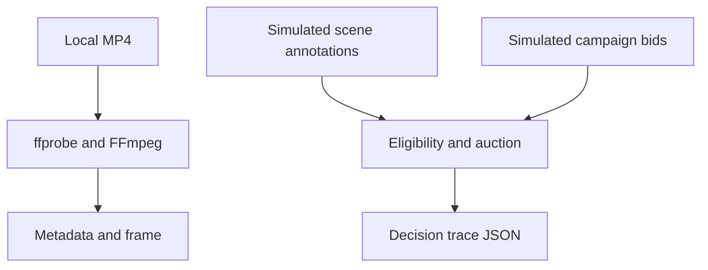

# SceneBid: Contextual Video Intelligence and Ad Decisions
### by Raymond Gan

SceneBid is a project to explore how timestamped video intelligence can inform a contextual ad decision. Its target is a local VOD file, `TV_Commercials_1977.mp4`, with a compilation of TV ads from 1977. Any ads selected against this video are a simulated contextual-placement exercise.

## Problem

A streaming publisher wants to understand video at the moment level, determine whether a placement is appropriate, and match available ad demand to that context. Relevant concerns include scene timing, suitability, direct and programmatic demand, decision latency, playback and measurement. SceneBid starts small and makes its assumptions visible.

## MVP Scope

The current starter provides two separate flows:

1. **Real media processing:** `analyze` uses `ffprobe` to record video metadata and `ffmpeg` to extract one frame at a specified timestamp. It does not interpret the image or transcribe speech.
2. **Simulated decisioning:** `decide` reads manually supplied scene labels and fictional bids, rejects scenes not marked safe, filters by matching category and floor, and selects the highest eligible simulated CPM. Results contain candidates and a decision reason.

The fixtures are simulated, not model predictions. The supplied commercial times are approximate; the Chevrolet end time is illustrative and should be checked against the actual file. The sample `unknown-scene` is a synthetic no-fill example and does not describe the video.

## Architecture



Future: a separate analysis worker may emit timestamped observations using CLIP and Whisper from In-Video Search. CLIP creates embeddings; FAISS can index and search vectors; Whisper transcribes audio. These models and dependencies are not included in this starter. Go remains responsible for orchestration, APIs and decisioning.

## Process Flow

1. Put the MP4 at `data/input/TV_Commercials_1977.mp4`.
2. Run `analyze` to generate `probe.json` and a sample JPEG in `data/output/TV_Commercials_1977/`.
3. Run `decide` to evaluate the separate synthetic scene and demand fixtures and write `decisions.json`.
4. Inspect both outputs. The simulated decisions are not linked automatically to the extracted frame or inferred from the video.

## Priorities

- **P0:** Reproducible local startup; actual FFmpeg probe/frame extraction; clearly labeled simulated scene data, safety rules, demand and decisions.
- **P1:** Process multiple timestamped windows; integrate real frame and transcript analysis behind a provider interface; preserve evidence and model versions; validate results against approximate chapter labels.
- **P2:** Mock OpenRTB request/response over HTTP between simulated SSP and DSP, timeouts and floor handling; integrate direct demand; render a contextual overlay in a browser.
- **P3:** VMAP/VAST output with an explicitly supported player; tracking and frequency caps; optional SSAI/HLS integration using the existing SSAI project.

## Repository Layout

```text
cmd/scenebid/       CLI entry point
internal/analysis/  FFmpeg/ffprobe integration
internal/auction/   Simulated eligibility and selection
internal/model/     Shared data types
internal/store/     JSON input and output
data/input/         Put TV_Commercials_1977.mp4 here; ignored by git
data/output/        Generated metadata, frames, decisions; ignored by git
data/fixtures/      Committed fictional scenes and bids
docs/               Future design notes
```

## Run and Verify

Requires Go 1.22+ and FFmpeg with `ffprobe` on your PATH. From the project root:

```bash
go test ./...
go run ./cmd/scenebid analyze -video data/input/TV_Commercials_1977.mp4 -at 5
go run ./cmd/scenebid decide
```

Inspect `data/output/TV_Commercials_1977/probe.json`, `frames/sample.jpg`, and `decisions.json`. The `decide` command can run without any video. To use a different frame timestamp or location, run `go run ./cmd/scenebid analyze -h`; `go run ./cmd/scenebid decide -h` shows decision options. Re-running overwrites these outputs.

## MVP Limitations

- No AI inference, transcript, automatic shot detection, video search, ad playback, VMAP/VAST, OpenRTB, SSAI, frequency caps or real DSPs are implemented yet.
- The sample auction is synchronous in-process filtering over fictional bids; no network calls, pacing, budgets or timeout behavior.
- Scene safety is a fixture. It is not a production safety classifier, and unknown means no fill.
- Times are illustrative; correct chapter and cut offsets against your own MP4.
- The video is a compilation of ads. Matching fictional campaigns to it does not demonstrate actual publisher inventory or licensed ad delivery.
- This is a local learning project, not a production system or a claim of protocol compliance. Keep video and generated media out of git; verify source rights before redistribution.

## Ad Tech Terms

- **Publisher / supply:** The party offering an ad opportunity.
- **Advertiser / demand:** A buyer seeking to show a campaign.
- **SSP:** A platform that helps publishers offer inventory to buyers.
- **DSP:** A platform that evaluates and bids for advertisers.
- **CPM:** Price per 1,000 impressions; the starter's CPM values are fictional.
- **Floor:** Minimum qualifying bid in the simulated auction.
- **OpenRTB:** A standard protocol for bid requests and responses; not implemented here.
- **VAST:** A standard describing video ad assets and tracking; not implemented here.
- **VMAP:** A format for describing scheduled ad breaks; not implemented here.
- **SSAI:** Server-side ad insertion, often through manifest manipulation; not implemented here.
- **Impression:** A measurement event under applicable rules, not merely an ad being selected.
